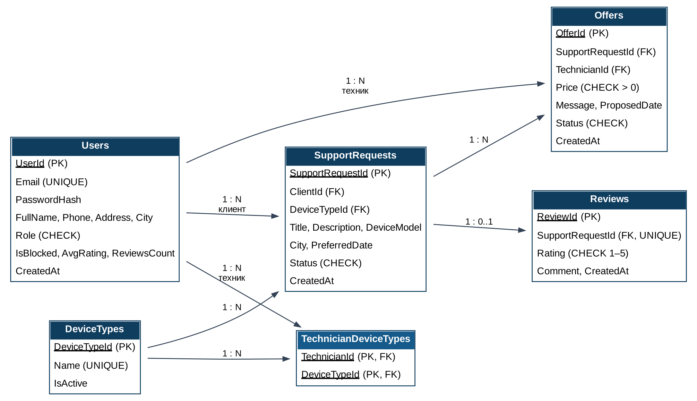

# ITspec — IT помощ за компютри и телефони

Уеб приложение по схемата **заявка → оферта → отзив**. Клиент описва проблем с компютър или телефон, техниците, които работят с този вид устройства, дават оферти, клиентът приема една, техникът решава проблема, а клиентът оставя отзив и оценка.

> Учебна практика: Интернет програмиране, 12 клас · Тема 8 от 12 · **Александър Калоянов**

> Работна версия: документацията се допълва с всяка стъпка от плана.

# Документация по стъпки

## Стъпка 1 — проблем, роли и потребителски истории

Тема 8: IT помощ — компютри и телефони · Александър Калоянов, 12 А

### Речник: демо → моят проект

| Обща дума | В демото HandymanHub | В ITspec |
|---|---|---|
| основна роля | Client (клиент) | Client (клиент) |
| втора роля | Handyman (майстор) | Technician (техник) |
| администратор | Admin | Admin |
| основен ресурс | заявка за ремонт (Request) | заявка за IT помощ (SupportRequest) |
| ресурс на втората роля | оферта (Offer) | оферта (Offer) |
| каталог | категория (Category) | вид устройство (DeviceType) |
| връзка много-към-много | майстор ↔ категории | техник ↔ видове устройства (TechnicianDeviceTypes) |
| завършващо действие | отзив с оценка (Review) | отзив с оценка (Review) |

### Проблем

Човек, на когото компютърът или телефонът спре да работи, днес звъни на познати „компютърджии“, чака и няма как да сравни цени, срокове и отзиви за изпълнителите.

### Роли

| Роля | Какво иска да постигне |
|---|---|
| Client | да опише проблема веднъж и да избере най-подходящата оферта |
| Technician | да намира заявки за устройствата, с които работи, и да печели клиенти |
| Admin | да поддържа видовете устройства и реда в системата |

### Потребителски истории

| № | История | Задължителна? |
|---|---|---|
| U1 | Като клиент искам да се регистрирам и да публикувам заявка с вида устройство и описание на проблема, за да ми дадат оферти подходящи техници. | да |
| U2 | Като клиент искам да сравня офертите по цена, дата и рейтинг на техника, за да избера най-изгодната. | да |
| U3 | Като клиент искам да приема една оферта, за да започне работата. | да |
| U4 | Като клиент искам да редактирам или прекратя заявката си, докато никой не е поел работата, за да не получавам оферти за грешен или вече решен проблем. | да |
| U5 | Като клиент искам да оставя оценка и отзив след завършената работа, за да помогна на другите клиенти. | по избор |
| U6 | Като техник искам да се регистрирам и да избера с кои видове устройства работя, за да виждам само подходящи заявки. | да |
| U7 | Като техник искам да виждам отворените заявки в моите видове и да давам оферта с цена и дата, за да спечеля клиента. | да |
| U8 | Като техник искам да оттегля оферта, докато не е приета, за да не поемам работа, за която вече нямам време. | по избор |
| U9 | Като техник искам след като ме изберат да видя адреса и телефона на клиента и после да отбележа работата като завършена, за да отида при него и да получа отзив. | да |
| U10 | Като администратор искам да добавям и деактивирам видове устройства, за да е актуален списъкът. | да |
| U11 | Като администратор искам да блокирам потребител, за да спра злоупотреби. | по избор |
| U12 | Като администратор искам да виждам всички заявки и обща статистика, за да знам дали системата се използва. | по избор |

Всяка роля има поне 3 истории. Пътят на основния ресурс е покрит целият: създаване (U1), реакция на другата роля (U7, U8), избор (U3), промяна и отказ (U4), завършване (U9) и оценка (U5).

### Не влиза

- **Плащания и фактури** — изискват договор с платежен оператор; клиентът и техникът се разплащат на място.
- **Чат между клиент и техник** — след приемане техникът вижда телефона (U9), това стига за връзка.
- **Снимки на повредата** — качване и пазене на файлове е отделна задача; описанието и моделът стигат за оферта.
- **Карта и разстояние до техника** — градът на заявката е достатъчен филтър.
- **Известия по имейл/SMS и възстановяване на парола** — изискват външна услуга за изпращане.

### Решения

- AI предложи да разделя регистрацията в отделна история „Като потребител искам да вляза“ → **отхвърлих**, защото входът не е цел; сложих го в първото действие на всяка роля (U1, U6).
- AI предложи история „Като посетител искам да разглеждам техниците“ → **отхвърлих** като отделна история, защото профилите на техниците са част от сравнението на офертите (U2).
- AI предложи чат като задължителна история → **отхвърлих** и го сложих в „Не влиза“, защото без него проектът пак решава проблема.
- AI посочи, че липсва история за промяна на заявката, а не само за отказ → **приех** и добавих „редактирам“ в U4 (от нея се раждат правилото R6 и `PUT /requests/{id}`).
- AI посочи, че админът има само една история → **приех** и добавих U11 и U12, за да има поне 3 истории на роля.

---


## Стъпка 2 — същности и връзки

ER диаграмата е в [`docs/02-er-diagram.png`](docs/02-er-diagram.png). Таблиците се създават от C# класовете в `Model/Entities` с миграцията `InitialCreate` (Code First), не на ръка в SSMS.



### Таблици

#### Users — всички потребители (клиент, техник, админ са една същност с различна роля)

| Колона | Тип | Задължителна? | Нужна за |
|---|---|---|---|
| UserId | int, PK, IDENTITY | да | — |
| Email | nvarchar(256), UNIQUE | да | U1, U6 (вход) |
| PasswordHash | nvarchar(max) | да | U1, U6 |
| FullName | nvarchar(100) | да | U2 (име на техника в офертата) |
| Phone | nvarchar(20) | не | U9 |
| Address | nvarchar(200) | не | U9 |
| City | nvarchar(60) | да | U1 (градът на заявката по подразбиране), U7 |
| Role | nvarchar(20), CHECK | да | всички (кой какво може) |
| IsBlocked | bit, по подразбиране 0 | да | U11 |
| AvgRating | decimal(3,2), CHECK 1–5 | не | U2 |
| ReviewsCount | int, по подразбиране 0 | да | U2 |
| CreatedAt | datetime2, от SQL Server | да | U12 |

#### DeviceTypes — каталогът

| Колона | Тип | Задължителна? | Нужна за |
|---|---|---|---|
| DeviceTypeId | int, PK | да | — |
| Name | nvarchar(60), UNIQUE | да | U1, U6, U10 |
| IsActive | bit | да | U10 (меко изтриване) |

#### TechnicianDeviceTypes — връзката N:M

| Колона | Тип | Задължителна? | Нужна за |
|---|---|---|---|
| TechnicianId | int, PK + FK → Users | да | U6, U7 |
| DeviceTypeId | int, PK + FK → DeviceTypes | да | U6, U7 |

#### SupportRequests — основният ресурс

| Колона | Тип | Задължителна? | Нужна за |
|---|---|---|---|
| SupportRequestId | int, PK | да | — |
| ClientId | int, FK → Users (собственик) | да | U1, U4 |
| DeviceTypeId | int, FK → DeviceTypes | да | U1, U7 |
| Title | nvarchar(120) | да | U1 |
| Description | nvarchar(2000) | да | U1 |
| DeviceModel | nvarchar(100) | не | U1, U7 |
| City | nvarchar(60) | да | U7 |
| PreferredDate | date | не | U1 |
| Status | nvarchar(20), CHECK (Open, Assigned, Completed, Cancelled) | да | U3, U4, U9 |
| CreatedAt | datetime2, от SQL Server | да | U7 (подредба) |

#### Offers — ресурсът на втората роля

| Колона | Тип | Задължителна? | Нужна за |
|---|---|---|---|
| OfferId | int, PK | да | — |
| SupportRequestId | int, FK → SupportRequests | да | U7 |
| TechnicianId | int, FK → Users | да | U7 |
| Price | decimal(10,2), CHECK > 0 | да | U2 |
| Message | nvarchar(1000) | не | U2 |
| ProposedDate | date | не | U2 |
| Status | nvarchar(20), CHECK (Pending, Accepted, Rejected, Withdrawn) | да | U3, U8 |
| CreatedAt | datetime2 | да | U2 |

UNIQUE (SupportRequestId, TechnicianId); филтриран UNIQUE (SupportRequestId) WHERE Status = 'Accepted'.

#### Reviews — завършващото действие

| Колона | Тип | Задължителна? | Нужна за |
|---|---|---|---|
| ReviewId | int, PK | да | — |
| SupportRequestId | int, FK, UNIQUE | да | U5 |
| Rating | tinyint, CHECK 1–5 | да | U5, U2 |
| Comment | nvarchar(1000) | не | U5 |
| CreatedAt | datetime2 | да | U5 |

### Връзки

| Връзка | Вид | Как се превежда |
|---|---|---|
| Клиент → Заявки | 1:N | ClientId в SupportRequests |
| Вид устройство → Заявки | 1:N | DeviceTypeId в SupportRequests |
| Техници ↔ Видове устройства | N:M | междинна таблица TechnicianDeviceTypes със съставен ключ |
| Заявка → Оферти | 1:N | SupportRequestId в Offers |
| Техник → Оферти | 1:N | TechnicianId в Offers |
| Заявка → Отзив | 1:0..1 | SupportRequestId в Reviews, уникален |

### Решения

- **Една таблица Users с колона Role, без таблица Roles.** Заданието на темата иска ролята като колона; трите стойности се пазят с CHECK. Отделни таблици за клиенти и техници биха дали два входа и две проверки за уникален имейл.
- **Няма таблица „Работа“.** Приетата оферта вече казва кой, кога и за колко, а статусът на заявката — дали е завършена.
- **Съзнателно дублиране:** AvgRating и ReviewsCount в Users може да се изчислят от отзивите, но се пазят, за да не се смятат при всяко търсене на техници. Цената е, че трябва да се обновяват — прави го `usp_AddReview` в същата транзакция, в която записва отзива.
- **Няма каскадно изтриване.** Потребителите се блокират, видовете се деактивират, заявките се прекратяват — историята остава.
- AI предложи колони UpdatedAt и IsDeleted във всички таблици → **отхвърлих**: нито една история не ги иска.
- AI предложи таблица Roles като в демото → **отхвърлих** заради заданието (виж първата точка).
- AI посочи, че за U9 трябва адрес на клиента → **приех** колоната Address в Users (по избор, защото не всеки клиент иска посещение).

---


## Стъпка 3 — бизнес правила

Колкото по-близо до данните е правилото, толкова по-трудно се заобикаля. Затова мястото се избира в този ред: **ограничение в базата → процедура с транзакция → проверка в API**.

### Статуси на заявката (SupportRequests.Status)


| От | Към | Кой го прави | История |
|---|---|---|---|
| (нова) | Open | клиентът | U1 |
| Open | Open (само съдържанието) | клиентът собственик | U4 |
| Open | Assigned | клиентът собственик, като приема оферта | U3 |
| Assigned | Completed | техникът с приетата оферта | U9 |
| Open, Assigned | Cancelled | клиентът собственик | U4 |

Всеки ненаписан преход е забранен (например Completed → Open, Cancelled → каквото и да е, редакция на Assigned).

### Статуси на офертата (Offers.Status)

| От | Към | Кой го прави | История |
|---|---|---|---|
| (нова) | Pending | техникът | U7 |
| Pending | Accepted | клиентът, като приема (процедурата) | U3 |
| Pending | Rejected | системата, когато е приета друга оферта или заявката е прекратена | U3, U4 |
| Pending | Withdrawn | техникът автор | U8 |

### Правила

| № | Правило | Къде се гарантира | Тест: опит → очакван резултат |
|---|---|---|---|
| R1 | Имейлът е уникален | UNIQUE индекс | втора регистрация със същия имейл → 409 |
| R2 | Ролята е само Client, Technician или Admin и не идва от front-end-а; Admin не се регистрира | CHECK + отделни адреси `register/client` и `register/technician` (DTO няма поле Role) | `"role": "Admin"` в тялото → 201, но като Client; INSERT с роля Boss в SSMS → грешка 547 |
| R3 | Техник дава оферта само по Open заявка в своите видове устройства | проверка в API (+ TechnicianDeviceTypes) | оферта извън вида → 403; по Assigned заявка → 409 |
| R4 | Един техник — една оферта на заявка | UNIQUE (SupportRequestId, TechnicianId) | втора оферта → 409 |
| R5 | При приемане точно една оферта е приета: тя става Accepted, другите чакащи Rejected, заявката Assigned; приема само собственикът | процедура `usp_AcceptOffer` с транзакция и заключване + филтриран UNIQUE индекс | второ приемане → 409, нищо не се променя; чужд клиент приема → 409 |
| R6 | Заявката се редактира само докато е Open, прекратява се само докато е Open или Assigned — и двете само от собственика | проверка в API (собственик и статус в WHERE на един UPDATE) | редакция на чужда → 404; на Assigned → 409; второ прекратяване → 409 |
| R7 | Завършва само техникът с приетата оферта и само Assigned заявка | проверка в API (UPDATE с условие) | друг техник → 404; втори път → 409 |
| R8 | Отзив само за своя Completed заявка, веднъж, с оценка 1–5; рейтингът на техника се обновява заедно с отзива | процедура `usp_AddReview` + UNIQUE (SupportRequestId) + CHECK | отзив преди завършване → 409; втори отзив → 409, рейтингът не се променя; оценка 7 → 400 |
| R9 | Адресът и телефонът на клиента се виждат само от техника с приетата оферта; телефонът на техника не е публичен | DTO в API; изгледите нямат тези колони | детайли от друг техник → `clientPhone: null`; списъкът с техници няма телефони |
| R10 | **Собствено правило:** техник не може да има повече от 3 поети (Assigned) заявки едновременно | процедура `usp_AcceptOffer`, със заключване на реда на техника | приемане на оферта на техник с 3 поети → 409, заявката остава Open |
| R11 | Видовете устройства на техник се сменят изцяло, само с активни видове | процедура `usp_SetTechnicianDeviceTypes` с табличен тип | списък с несъществуващ вид → 409, старите остават |
| R12 | Блокиран потребител не влиза | проверка при вход (API) | вход с блокиран акаунт → 403 |
| R13 | Чужд запис се вижда като несъществуващ | проверка в API (собственикът е в заявката към базата) | детайли на чужда заявка → 404 |

Видове гаранции, които се срещат: UNIQUE (R1, R4), CHECK (R2, R8), процедура с транзакция (R5, R8, R10, R11), проверка в API (R3, R6, R7, R12, R13), DTO (R9).

### Защо R10 е в процедурата

Броят поети заявки идва от няколко реда в две таблици, затова не може да е CHECK. Ако проверката е само в C#, двама клиенти в една и съща секунда ще видят по 2 поети заявки и ще дадат на техника 4. В процедурата редът на техника се заключва (UPDLOCK), така че втората транзакция чака първата и вижда вече 3.

### Какво става, ако приемането спре по средата без транзакция

Офертата може да остане Accepted, а заявката — Open: техниците ще продължат да дават оферти, а клиентът може да приеме и втора. Затова трите промени са в една транзакция: всичко или нищо.

### Процедури и изгледи, които се раждат от правилата

- процедура `usp_AcceptOffer` — заради R5 и R10: променя Offers (2 пъти) и SupportRequests;
- процедура `usp_AddReview` — заради R8: пише в Reviews и обновява Users;
- процедура `usp_SetTechnicianDeviceTypes` + табличен тип `IdListType` — заради R11: трие и вмъква в TechnicianDeviceTypes наведнъж;
- изглед `vw_OpenSupportRequests` — за честия въпрос „кои заявки чакат оферти?“ (U7), без адрес и телефон;
- изглед `vw_TechnicianProfiles` — за „какъв е този техник?“ (U2), без телефон и без блокираните.

### Решения

- AI предложи R6 (редакция само в Open) да е тригер в базата → **отхвърлих**: правилото зависи от това кой пита (собственик от токена), затова е в API, но с условие в самия UPDATE, така че няма „прочети → провери → запиши“.
- AI предложи процедура и за прекратяването → **отхвърлих**: то променя един ред в SupportRequests и чакащите оферти с два UPDATE-а; сложих ги в обща транзакция в C#, без отделна процедура.
- AI откри, че R10 е засегнато от едновременни заявки → **приех** и добавих заключване на реда на техника в `usp_AcceptOffer`.
- AI предложи 403 за чужд запис → **отхвърлих** и избрах 404 навсякъде (R13): 404 не издава, че записът съществува. Изключение е приемането на оферта (R5): там проверката е вътре в процедурата и тя връща 409, защото тестовете на процедурата в SSMS очакват грешка 50002.

---


## Стъпка 4 — API договор

Текущият потребител винаги идва от JWT токена — нито един адрес и нито едно тяло не съдържа неговото Id. Статусът никога не се праща от клиента: всеки преход от [Стъпка 3 — бизнес правила](#стъпка-3--бизнес-правила) е отделен POST към под-адрес. Грешките са във формат ProblemDetails.

**Кодове:** 200 четене или действие с отговор · 201 създадено (+ Location) · 204 успех без тяло · 400 невалидни данни · 401 не си влязъл · 403 грешна роля · 404 няма такъв запис **или е чужд** · 409 нарушено правило.

### Endpoints

| Метод и адрес | Роля | Успех | Възможни грешки (правило) | История |
|---|---|---|---|---|
| POST /auth/register/client | всички | 201 | 400, 409 (R1) | U1 |
| POST /auth/register/technician | всички | 201 | 400, 409 (R1) | U6 |
| POST /auth/login | всички | 200 + токен | 400, 401, 403 (R12) | U1, U6 |
| GET /auth/me | логнат | 200 | 401 | U1, U6 |
| GET /device-types | всички | 200 (само активните, с брой заявки) | — | U1, U6 |
| GET /device-types/{id} | всички | 200 | 404 | U10 |
| POST /device-types | Admin | 201 + Location | 400, 403, 409 (уникално име) | U10 |
| PUT /device-types/{id} | Admin | 204 | 400, 403, 404, 409 | U10 |
| DELETE /device-types/{id} | Admin | 204 (IsActive = false) | 403, 404 | U10 |
| GET /requests/open?deviceTypeId=&city=&search= | всички, без вход | 200 (от `vw_OpenSupportRequests`) | — | U7 |
| GET /requests | логнат | 200 (според ролята) — **остаряла**, виж v2 | 401 | U1, U7, U12 |
| GET /requests/mine?status=&page= | Client | 200 (само своите, по 20) | 401, 403 | U1, U4 |
| GET /requests/{id} | собственик / техник с оферта или от вида / Admin | 200 | 404 (R13) | U2, U9 |
| POST /requests | Client | 201 + Location | 400 (неактивен вид) | U1 |
| PUT /requests/{id} | Client (собственик) | 204 | 400, 404 (R13), 409 (R6) | U4 |
| POST /requests/{id}/cancel | Client (собственик) | 204 | 404 (R13), 409 (R6) | U4 |
| GET /requests/{id}/offers | Client (собственик), Admin | 200 | 404 (R13) | U2 |
| POST /requests/{id}/offers | Technician | 201 | 400, 403 (R3), 404, 409 (R3, R4) | U7 |
| GET /offers/mine | Technician | 200 | 403 | U7, U8 |
| POST /offers/{id}/accept | Client (собственик) | 200 | 409 (R5, R10) | U3 |
| POST /offers/{id}/withdraw | Technician (автор) | 204 | 404 (R13), 409 | U8 |
| POST /requests/{id}/complete | Technician (приетата оферта) | 204 | 404 (R13), 409 (R7) | U9 |
| POST /requests/{id}/review | Client (собственик) | 201 | 400 (R8), 409 (R8) | U5 |
| GET /technicians?deviceTypeId=&city=&page= | всички, без вход | 200 (от `vw_TechnicianProfiles`) | — | U2 |
| GET /technicians/{id} | всички | 200 + отзиви | 404 | U2 |
| GET, PUT /technicians/me/profile | Technician | 200 / 204 | 400, 403 | U6, U9 |
| GET, PUT /technicians/me/device-types | Technician | 200 / 204 | 403, 409 (R11) | U6 |
| GET /admin/users?role=&blocked=&page= | Admin | 200 (без PasswordHash) | 401, 403 | U11 |
| POST /admin/users/{id}/block, /unblock | Admin | 204 | 404, 409 (себе си / друг админ) | U11 |
| GET /admin/requests?status=&page= | Admin | 200 | 403 | U12 |
| GET /admin/stats | Admin | 200 | 403 | U12 |
| GET **/api/v2**/requests?status=&deviceTypeId=&page=&pageSize= | логнат | 200 `{ items, page, pageSize, total }` | 401 | U1, U7, U12 |

Всяко правило се вижда като код: R1 → 409 при регистрация; R3 → 403/409 при оферта; R4 → 409; R5, R10 → 409 при приемане; R6 → 409 при PUT и cancel; R7 → 409 при complete; R8 → 400/409 при отзив; R11 → 409; R12 → 403 при вход; R13 → 404.

### Примери

#### POST /auth/login

Заявка:
```json
{ "email": "maria@itspec.local", "password": "Demo123!" }
```
Отговор 200 (без парола и без хеш):
```json
{ "token": "eyJ...", "expiresAt": "2026-11-18T14:00:00Z",
  "user": { "userId": 2, "fullName": "Мария Иванова", "email": "maria@itspec.local", "city": "Враца", "role": "Client" } }
```
Грешка 401: `{ "title": "Грешен имейл или парола.", "status": 401 }` — еднакво за грешен имейл и грешна парола.

#### POST /requests

Заявка (няма clientId, status и createdAt — сървърът ги попълва):
```json
{ "deviceTypeId": 1, "title": "Лаптопът не зарежда",
  "description": "Зарядното свети, но батерията стои на 0%.", "deviceModel": "Acer Aspire 5" }
```
Отговор `201 Created`, `Location: /api/v1/requests/7`, тялото е детайлите на заявката със `"status": "Open"`.
Грешка 400: `{ "title": "Изберете съществуващ и активен вид устройство.", "status": 400 }`.

#### POST /offers/12/accept

Отговор 200:
```json
{ "offerId": 12, "supportRequestId": 7, "requestStatus": "Assigned" }
```
Грешка 409 (R10):
```json
{ "title": "Техникът вече има 3 поети заявки и не може да поеме нова. Изберете друга оферта.", "status": 409 }
```

### Решения

- AI предложи `PATCH /requests/{id}` с `{"status": ...}` вместо отделни действия → **отхвърлих**: така клиентът решава статуса и проверката на преходите е на едно място за всички — лесно се пропуска случай. Всеки преход е отделен адрес (`/accept`, `/cancel`, `/complete`, `/withdraw`).
- AI предложи 403 за чужд запис → **отхвърлих**, избрах 404 навсякъде (R13), за да не се издава, че записът съществува. Изключение: `/offers/{id}/accept` връща 409 от процедурата (виж [Стъпка 3 — бизнес правила](#стъпка-3--бизнес-правила)).
- AI предложи `/users/{id}/requests` за „моите заявки“ → **отхвърлих**: Id-то щеше да е в адреса; направих `/requests/mine`, където собственикът е от токена.
- AI посочи, че липсва адрес за публичното търсене на техници с филтри → **приех** `GET /technicians?deviceTypeId=&city=&page=`.
- Междинната таблица TechnicianDeviceTypes не е ресурс: променя се изцяло през `PUT /technicians/me/device-types`.

---
