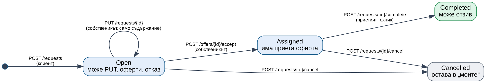

# ITspec — IT помощ за компютри и телефони

Уеб приложение по схемата **заявка → оферта → отзив**. Клиент описва проблем с компютър или телефон, техниците, които работят с този вид устройства, дават оферти, клиентът приема една, техникът решава проблема, а клиентът оставя отзив и оценка.

> Учебна практика: Интернет програмиране, 12 клас · Тема 8 от 12 · **Александър Калоянов**

> Работна версия: документацията се допълва с всяка стъпка от плана.

# Документация по стъпки

## Стъпка 1 — проблем, роли и потребителски истории

Тема 8: IT помощ — компютри и телефони · Александър Калоянов, 12 А

### Речник: демо → моят проект

| Обща дума | В демото HandymanHub | В ITspec |
|---|---|---|
| основна роля | Client (клиент) | Client (клиент) |
| втора роля | Handyman (майстор) | Technician (техник) |
| администратор | Admin | Admin |
| основен ресурс | заявка за ремонт (Request) | заявка за IT помощ (SupportRequest) |
| ресурс на втората роля | оферта (Offer) | оферта (Offer) |
| каталог | категория (Category) | вид устройство (DeviceType) |
| връзка много-към-много | майстор ↔ категории | техник ↔ видове устройства (TechnicianDeviceTypes) |
| завършващо действие | отзив с оценка (Review) | отзив с оценка (Review) |

### Проблем

Човек, на когото компютърът или телефонът спре да работи, днес звъни на познати „компютърджии“, чака и няма как да сравни цени, срокове и отзиви за изпълнителите.

### Роли

| Роля | Какво иска да постигне |
|---|---|
| Client | да опише проблема веднъж и да избере най-подходящата оферта |
| Technician | да намира заявки за устройствата, с които работи, и да печели клиенти |
| Admin | да поддържа видовете устройства и реда в системата |

### Потребителски истории

| № | История | Задължителна? |
|---|---|---|
| U1 | Като клиент искам да се регистрирам и да публикувам заявка с вида устройство и описание на проблема, за да ми дадат оферти подходящи техници. | да |
| U2 | Като клиент искам да сравня офертите по цена, дата и рейтинг на техника, за да избера най-изгодната. | да |
| U3 | Като клиент искам да приема една оферта, за да започне работата. | да |
| U4 | Като клиент искам да редактирам или прекратя заявката си, докато никой не е поел работата, за да не получавам оферти за грешен или вече решен проблем. | да |
| U5 | Като клиент искам да оставя оценка и отзив след завършената работа, за да помогна на другите клиенти. | по избор |
| U6 | Като техник искам да се регистрирам и да избера с кои видове устройства работя, за да виждам само подходящи заявки. | да |
| U7 | Като техник искам да виждам отворените заявки в моите видове и да давам оферта с цена и дата, за да спечеля клиента. | да |
| U8 | Като техник искам да оттегля оферта, докато не е приета, за да не поемам работа, за която вече нямам време. | по избор |
| U9 | Като техник искам след като ме изберат да видя адреса и телефона на клиента и после да отбележа работата като завършена, за да отида при него и да получа отзив. | да |
| U10 | Като администратор искам да добавям и деактивирам видове устройства, за да е актуален списъкът. | да |
| U11 | Като администратор искам да блокирам потребител, за да спра злоупотреби. | по избор |
| U12 | Като администратор искам да виждам всички заявки и обща статистика, за да знам дали системата се използва. | по избор |

Всяка роля има поне 3 истории. Пътят на основния ресурс е покрит целият: създаване (U1), реакция на другата роля (U7, U8), избор (U3), промяна и отказ (U4), завършване (U9) и оценка (U5).

### Не влиза

- **Плащания и фактури** — изискват договор с платежен оператор; клиентът и техникът се разплащат на място.
- **Чат между клиент и техник** — след приемане техникът вижда телефона (U9), това стига за връзка.
- **Снимки на повредата** — качване и пазене на файлове е отделна задача; описанието и моделът стигат за оферта.
- **Карта и разстояние до техника** — градът на заявката е достатъчен филтър.
- **Известия по имейл/SMS и възстановяване на парола** — изискват външна услуга за изпращане.

### Решения

- AI предложи да разделя регистрацията в отделна история „Като потребител искам да вляза“ → **отхвърлих**, защото входът не е цел; сложих го в първото действие на всяка роля (U1, U6).
- AI предложи история „Като посетител искам да разглеждам техниците“ → **отхвърлих** като отделна история, защото профилите на техниците са част от сравнението на офертите (U2).
- AI предложи чат като задължителна история → **отхвърлих** и го сложих в „Не влиза“, защото без него проектът пак решава проблема.
- AI посочи, че липсва история за промяна на заявката, а не само за отказ → **приех** и добавих „редактирам“ в U4 (от нея се раждат правилото R6 и `PUT /requests/{id}`).
- AI посочи, че админът има само една история → **приех** и добавих U11 и U12, за да има поне 3 истории на роля.

---


## Стъпка 2 — същности и връзки

ER диаграмата е в [`docs/02-er-diagram.png`](docs/02-er-diagram.png). Таблиците се създават от C# класовете в `Model/Entities` с миграцията `InitialCreate` (Code First), не на ръка в SSMS.


### Таблици

#### Users — всички потребители (клиент, техник, админ са една същност с различна роля)

| Колона | Тип | Задължителна? | Нужна за |
|---|---|---|---|
| UserId | int, PK, IDENTITY | да | — |
| Email | nvarchar(256), UNIQUE | да | U1, U6 (вход) |
| PasswordHash | nvarchar(max) | да | U1, U6 |
| FullName | nvarchar(100) | да | U2 (име на техника в офертата) |
| Phone | nvarchar(20) | не | U9 |
| Address | nvarchar(200) | не | U9 |
| City | nvarchar(60) | да | U1 (градът на заявката по подразбиране), U7 |
| Role | nvarchar(20), CHECK | да | всички (кой какво може) |
| IsBlocked | bit, по подразбиране 0 | да | U11 |
| AvgRating | decimal(3,2), CHECK 1–5 | не | U2 |
| ReviewsCount | int, по подразбиране 0 | да | U2 |
| CreatedAt | datetime2, от SQL Server | да | U12 |

#### DeviceTypes — каталогът

| Колона | Тип | Задължителна? | Нужна за |
|---|---|---|---|
| DeviceTypeId | int, PK | да | — |
| Name | nvarchar(60), UNIQUE | да | U1, U6, U10 |
| IsActive | bit | да | U10 (меко изтриване) |

#### TechnicianDeviceTypes — връзката N:M

| Колона | Тип | Задължителна? | Нужна за |
|---|---|---|---|
| TechnicianId | int, PK + FK → Users | да | U6, U7 |
| DeviceTypeId | int, PK + FK → DeviceTypes | да | U6, U7 |

#### SupportRequests — основният ресурс

| Колона | Тип | Задължителна? | Нужна за |
|---|---|---|---|
| SupportRequestId | int, PK | да | — |
| ClientId | int, FK → Users (собственик) | да | U1, U4 |
| DeviceTypeId | int, FK → DeviceTypes | да | U1, U7 |
| Title | nvarchar(120) | да | U1 |
| Description | nvarchar(2000) | да | U1 |
| DeviceModel | nvarchar(100) | не | U1, U7 |
| City | nvarchar(60) | да | U7 |
| PreferredDate | date | не | U1 |
| Status | nvarchar(20), CHECK (Open, Assigned, Completed, Cancelled) | да | U3, U4, U9 |
| CreatedAt | datetime2, от SQL Server | да | U7 (подредба) |

#### Offers — ресурсът на втората роля

| Колона | Тип | Задължителна? | Нужна за |
|---|---|---|---|
| OfferId | int, PK | да | — |
| SupportRequestId | int, FK → SupportRequests | да | U7 |
| TechnicianId | int, FK → Users | да | U7 |
| Price | decimal(10,2), CHECK > 0 | да | U2 |
| Message | nvarchar(1000) | не | U2 |
| ProposedDate | date | не | U2 |
| Status | nvarchar(20), CHECK (Pending, Accepted, Rejected, Withdrawn) | да | U3, U8 |
| CreatedAt | datetime2 | да | U2 |

UNIQUE (SupportRequestId, TechnicianId); филтриран UNIQUE (SupportRequestId) WHERE Status = 'Accepted'.

#### Reviews — завършващото действие

| Колона | Тип | Задължителна? | Нужна за |
|---|---|---|---|
| ReviewId | int, PK | да | — |
| SupportRequestId | int, FK, UNIQUE | да | U5 |
| Rating | tinyint, CHECK 1–5 | да | U5, U2 |
| Comment | nvarchar(1000) | не | U5 |
| CreatedAt | datetime2 | да | U5 |

### Връзки

| Връзка | Вид | Как се превежда |
|---|---|---|
| Клиент → Заявки | 1:N | ClientId в SupportRequests |
| Вид устройство → Заявки | 1:N | DeviceTypeId в SupportRequests |
| Техници ↔ Видове устройства | N:M | междинна таблица TechnicianDeviceTypes със съставен ключ |
| Заявка → Оферти | 1:N | SupportRequestId в Offers |
| Техник → Оферти | 1:N | TechnicianId в Offers |
| Заявка → Отзив | 1:0..1 | SupportRequestId в Reviews, уникален |

### Решения

- **Една таблица Users с колона Role, без таблица Roles.** Заданието на темата иска ролята като колона; трите стойности се пазят с CHECK. Отделни таблици за клиенти и техници биха дали два входа и две проверки за уникален имейл.
- **Няма таблица „Работа“.** Приетата оферта вече казва кой, кога и за колко, а статусът на заявката — дали е завършена.
- **Съзнателно дублиране:** AvgRating и ReviewsCount в Users може да се изчислят от отзивите, но се пазят, за да не се смятат при всяко търсене на техници. Цената е, че трябва да се обновяват — прави го `usp_AddReview` в същата транзакция, в която записва отзива.
- **Няма каскадно изтриване.** Потребителите се блокират, видовете се деактивират, заявките се прекратяват — историята остава.
- AI предложи колони UpdatedAt и IsDeleted във всички таблици → **отхвърлих**: нито една история не ги иска.
- AI предложи таблица Roles като в демото → **отхвърлих** заради заданието (виж първата точка).
- AI посочи, че за U9 трябва адрес на клиента → **приех** колоната Address в Users (по избор, защото не всеки клиент иска посещение).

---


## Стъпка 3 — бизнес правила

Колкото по-близо до данните е правилото, толкова по-трудно се заобикаля. Затова мястото се избира в този ред: **ограничение в базата → процедура с транзакция → проверка в API**.

### Статуси на заявката (SupportRequests.Status)



| От | Към | Кой го прави | История |
|---|---|---|---|
| (нова) | Open | клиентът | U1 |
| Open | Open (само съдържанието) | клиентът собственик | U4 |
| Open | Assigned | клиентът собственик, като приема оферта | U3 |
| Assigned | Completed | техникът с приетата оферта | U9 |
| Open, Assigned | Cancelled | клиентът собственик | U4 |

Всеки ненаписан преход е забранен (например Completed → Open, Cancelled → каквото и да е, редакция на Assigned).

### Статуси на офертата (Offers.Status)

| От | Към | Кой го прави | История |
|---|---|---|---|
| (нова) | Pending | техникът | U7 |
| Pending | Accepted | клиентът, като приема (процедурата) | U3 |
| Pending | Rejected | системата, когато е приета друга оферта или заявката е прекратена | U3, U4 |
| Pending | Withdrawn | техникът автор | U8 |

### Правила

| № | Правило | Къде се гарантира | Тест: опит → очакван резултат |
|---|---|---|---|
| R1 | Имейлът е уникален | UNIQUE индекс | втора регистрация със същия имейл → 409 |
| R2 | Ролята е само Client, Technician или Admin и не идва от front-end-а; Admin не се регистрира | CHECK + отделни адреси `register/client` и `register/technician` (DTO няма поле Role) | `"role": "Admin"` в тялото → 201, но като Client; INSERT с роля Boss в SSMS → грешка 547 |
| R3 | Техник дава оферта само по Open заявка в своите видове устройства | проверка в API (+ TechnicianDeviceTypes) | оферта извън вида → 403; по Assigned заявка → 409 |
| R4 | Един техник — една оферта на заявка | UNIQUE (SupportRequestId, TechnicianId) | втора оферта → 409 |
| R5 | При приемане точно една оферта е приета: тя става Accepted, другите чакащи Rejected, заявката Assigned; приема само собственикът | процедура `usp_AcceptOffer` с транзакция и заключване + филтриран UNIQUE индекс | второ приемане → 409, нищо не се променя; чужд клиент приема → 409 |
| R6 | Заявката се редактира само докато е Open, прекратява се само докато е Open или Assigned — и двете само от собственика | проверка в API (собственик и статус в WHERE на един UPDATE) | редакция на чужда → 404; на Assigned → 409; второ прекратяване → 409 |
| R7 | Завършва само техникът с приетата оферта и само Assigned заявка | проверка в API (UPDATE с условие) | друг техник → 404; втори път → 409 |
| R8 | Отзив само за своя Completed заявка, веднъж, с оценка 1–5; рейтингът на техника се обновява заедно с отзива | процедура `usp_AddReview` + UNIQUE (SupportRequestId) + CHECK | отзив преди завършване → 409; втори отзив → 409, рейтингът не се променя; оценка 7 → 400 |
| R9 | Адресът и телефонът на клиента се виждат само от техника с приетата оферта; телефонът на техника не е публичен | DTO в API; изгледите нямат тези колони | детайли от друг техник → `clientPhone: null`; списъкът с техници няма телефони |
| R10 | **Собствено правило:** техник не може да има повече от 3 поети (Assigned) заявки едновременно | процедура `usp_AcceptOffer`, със заключване на реда на техника | приемане на оферта на техник с 3 поети → 409, заявката остава Open |
| R11 | Видовете устройства на техник се сменят изцяло, само с активни видове | процедура `usp_SetTechnicianDeviceTypes` с табличен тип | списък с несъществуващ вид → 409, старите остават |
| R12 | Блокиран потребител не влиза | проверка при вход (API) | вход с блокиран акаунт → 403 |
| R13 | Чужд запис се вижда като несъществуващ | проверка в API (собственикът е в заявката към базата) | детайли на чужда заявка → 404 |

Видове гаранции, които се срещат: UNIQUE (R1, R4), CHECK (R2, R8), процедура с транзакция (R5, R8, R10, R11), проверка в API (R3, R6, R7, R12, R13), DTO (R9).

### Защо R10 е в процедурата

Броят поети заявки идва от няколко реда в две таблици, затова не може да е CHECK. Ако проверката е само в C#, двама клиенти в една и съща секунда ще видят по 2 поети заявки и ще дадат на техника 4. В процедурата редът на техника се заключва (UPDLOCK), така че втората транзакция чака първата и вижда вече 3.

### Какво става, ако приемането спре по средата без транзакция

Офертата може да остане Accepted, а заявката — Open: техниците ще продължат да дават оферти, а клиентът може да приеме и втора. Затова трите промени са в една транзакция: всичко или нищо.

### Процедури и изгледи, които се раждат от правилата

- процедура `usp_AcceptOffer` — заради R5 и R10: променя Offers (2 пъти) и SupportRequests;
- процедура `usp_AddReview` — заради R8: пише в Reviews и обновява Users;
- процедура `usp_SetTechnicianDeviceTypes` + табличен тип `IdListType` — заради R11: трие и вмъква в TechnicianDeviceTypes наведнъж;
- изглед `vw_OpenSupportRequests` — за честия въпрос „кои заявки чакат оферти?“ (U7), без адрес и телефон;
- изглед `vw_TechnicianProfiles` — за „какъв е този техник?“ (U2), без телефон и без блокираните.

### Решения

- AI предложи R6 (редакция само в Open) да е тригер в базата → **отхвърлих**: правилото зависи от това кой пита (собственик от токена), затова е в API, но с условие в самия UPDATE, така че няма „прочети → провери → запиши“.
- AI предложи процедура и за прекратяването → **отхвърлих**: то променя един ред в SupportRequests и чакащите оферти с два UPDATE-а; сложих ги в обща транзакция в C#, без отделна процедура.
- AI откри, че R10 е засегнато от едновременни заявки → **приех** и добавих заключване на реда на техника в `usp_AcceptOffer`.
- AI предложи 403 за чужд запис → **отхвърлих** и избрах 404 навсякъде (R13): 404 не издава, че записът съществува. Изключение е приемането на оферта (R5): там проверката е вътре в процедурата и тя връща 409, защото тестовете на процедурата в SSMS очакват грешка 50002.

---


## Стъпка 4 — API договор

Текущият потребител винаги идва от JWT токена — нито един адрес и нито едно тяло не съдържа неговото Id. Статусът никога не се праща от клиента: всеки преход от [Стъпка 3 — бизнес правила](#стъпка-3--бизнес-правила) е отделен POST към под-адрес. Грешките са във формат ProblemDetails.

**Кодове:** 200 четене или действие с отговор · 201 създадено (+ Location) · 204 успех без тяло · 400 невалидни данни · 401 не си влязъл · 403 грешна роля · 404 няма такъв запис **или е чужд** · 409 нарушено правило.

### Endpoints

| Метод и адрес | Роля | Успех | Възможни грешки (правило) | История |
|---|---|---|---|---|
| POST /auth/register/client | всички | 201 | 400, 409 (R1) | U1 |
| POST /auth/register/technician | всички | 201 | 400, 409 (R1) | U6 |
| POST /auth/login | всички | 200 + токен | 400, 401, 403 (R12) | U1, U6 |
| GET /auth/me | логнат | 200 | 401 | U1, U6 |
| GET /device-types | всички | 200 (само активните, с брой заявки) | — | U1, U6 |
| GET /device-types/{id} | всички | 200 | 404 | U10 |
| POST /device-types | Admin | 201 + Location | 400, 403, 409 (уникално име) | U10 |
| PUT /device-types/{id} | Admin | 204 | 400, 403, 404, 409 | U10 |
| DELETE /device-types/{id} | Admin | 204 (IsActive = false) | 403, 404 | U10 |
| GET /requests/open?deviceTypeId=&city=&search= | всички, без вход | 200 (от `vw_OpenSupportRequests`) | — | U7 |
| GET /requests | логнат | 200 (според ролята) — **остаряла**, виж v2 | 401 | U1, U7, U12 |
| GET /requests/mine?status=&page= | Client | 200 (само своите, по 20) | 401, 403 | U1, U4 |
| GET /requests/{id} | собственик / техник с оферта или от вида / Admin | 200 | 404 (R13) | U2, U9 |
| POST /requests | Client | 201 + Location | 400 (неактивен вид) | U1 |
| PUT /requests/{id} | Client (собственик) | 204 | 400, 404 (R13), 409 (R6) | U4 |
| POST /requests/{id}/cancel | Client (собственик) | 204 | 404 (R13), 409 (R6) | U4 |
| GET /requests/{id}/offers | Client (собственик), Admin | 200 | 404 (R13) | U2 |
| POST /requests/{id}/offers | Technician | 201 | 400, 403 (R3), 404, 409 (R3, R4) | U7 |
| GET /offers/mine | Technician | 200 | 403 | U7, U8 |
| POST /offers/{id}/accept | Client (собственик) | 200 | 409 (R5, R10) | U3 |
| POST /offers/{id}/withdraw | Technician (автор) | 204 | 404 (R13), 409 | U8 |
| POST /requests/{id}/complete | Technician (приетата оферта) | 204 | 404 (R13), 409 (R7) | U9 |
| POST /requests/{id}/review | Client (собственик) | 201 | 400 (R8), 409 (R8) | U5 |
| GET /technicians?deviceTypeId=&city=&page= | всички, без вход | 200 (от `vw_TechnicianProfiles`) | — | U2 |
| GET /technicians/{id} | всички | 200 + отзиви | 404 | U2 |
| GET, PUT /technicians/me/profile | Technician | 200 / 204 | 400, 403 | U6, U9 |
| GET, PUT /technicians/me/device-types | Technician | 200 / 204 | 403, 409 (R11) | U6 |
| GET /admin/users?role=&blocked=&page= | Admin | 200 (без PasswordHash) | 401, 403 | U11 |
| POST /admin/users/{id}/block, /unblock | Admin | 204 | 404, 409 (себе си / друг админ) | U11 |
| GET /admin/requests?status=&page= | Admin | 200 | 403 | U12 |
| GET /admin/stats | Admin | 200 | 403 | U12 |
| GET **/api/v2**/requests?status=&deviceTypeId=&page=&pageSize= | логнат | 200 `{ items, page, pageSize, total }` | 401 | U1, U7, U12 |

Всяко правило се вижда като код: R1 → 409 при регистрация; R3 → 403/409 при оферта; R4 → 409; R5, R10 → 409 при приемане; R6 → 409 при PUT и cancel; R7 → 409 при complete; R8 → 400/409 при отзив; R11 → 409; R12 → 403 при вход; R13 → 404.

### Примери

#### POST /auth/login

Заявка:
```json
{ "email": "maria@itspec.local", "password": "Demo123!" }
```
Отговор 200 (без парола и без хеш):
```json
{ "token": "eyJ...", "expiresAt": "2026-11-18T14:00:00Z",
  "user": { "userId": 2, "fullName": "Мария Иванова", "email": "maria@itspec.local", "city": "Враца", "role": "Client" } }
```
Грешка 401: `{ "title": "Грешен имейл или парола.", "status": 401 }` — еднакво за грешен имейл и грешна парола.

#### POST /requests

Заявка (няма clientId, status и createdAt — сървърът ги попълва):
```json
{ "deviceTypeId": 1, "title": "Лаптопът не зарежда",
  "description": "Зарядното свети, но батерията стои на 0%.", "deviceModel": "Acer Aspire 5" }
```
Отговор `201 Created`, `Location: /api/v1/requests/7`, тялото е детайлите на заявката със `"status": "Open"`.
Грешка 400: `{ "title": "Изберете съществуващ и активен вид устройство.", "status": 400 }`.

#### POST /offers/12/accept

Отговор 200:
```json
{ "offerId": 12, "supportRequestId": 7, "requestStatus": "Assigned" }
```
Грешка 409 (R10):
```json
{ "title": "Техникът вече има 3 поети заявки и не може да поеме нова. Изберете друга оферта.", "status": 409 }
```

### Решения

- AI предложи `PATCH /requests/{id}` с `{"status": ...}` вместо отделни действия → **отхвърлих**: така клиентът решава статуса и проверката на преходите е на едно място за всички — лесно се пропуска случай. Всеки преход е отделен адрес (`/accept`, `/cancel`, `/complete`, `/withdraw`).
- AI предложи 403 за чужд запис → **отхвърлих**, избрах 404 навсякъде (R13), за да не се издава, че записът съществува. Изключение: `/offers/{id}/accept` връща 409 от процедурата (виж [Стъпка 3 — бизнес правила](#стъпка-3--бизнес-правила)).
- AI предложи `/users/{id}/requests` за „моите заявки“ → **отхвърлих**: Id-то щеше да е в адреса; направих `/requests/mine`, където собственикът е от токена.
- AI посочи, че липсва адрес за публичното търсене на техници с филтри → **приех** `GET /technicians?deviceTypeId=&city=&page=`.
- Междинната таблица TechnicianDeviceTypes не е ресурс: променя се изцяло през `PUT /technicians/me/device-types`.

---


## Стъпка 5 — екрани

Екраните са спецификацията за front-end-а (стъпка 11): какво показва всеки екран и от кой endpoint идват данните. Самите екрани още не са направени — до стъпка 10 API-то се проверява със Swagger и `.http`. Скиците (телефонен вид) са в [`docs/05-wireframes/`](docs/05-wireframes).

### Екрани

| Екран | Роля | Данни от | Бутони → endpoint | Скица |
|---|---|---|---|---|
| Начало — дъска с обяви (търсачка, категории, обяви, най-добри техници) | всички, без вход | GET /requests/open, GET /device-types, GET /technicians | „Търси“ → GET /requests/open?…; обява → детайли | [01-nachalo.png](docs/05-wireframes/01-nachalo.png) |
| Вход и регистрация | всички | — | „Вход“ → POST /auth/login; „Аз съм клиент/техник“ → POST /auth/register/client или /technician | [02-vhod.png](docs/05-wireframes/02-vhod.png) |
| Нова заявка / Редакция | Client | GET /device-types (+ GET /requests/{id} при редакция) | „Публикувай“ → POST /requests; „Запази промените“ → PUT /requests/{id} | [03-nova-zayavka.png](docs/05-wireframes/03-nova-zayavka.png) |
| Списък със заявки | Client, Technician, Admin | GET /requests | заявка → детайли | — (списък като на началото) |
| Детайли на заявка (клиент) | Client | GET /requests/{id}, GET /requests/{id}/offers | „Приеми“ → POST /offers/{id}/accept; „Редактирай“ → екран 3; „Прекрати“ → POST /requests/{id}/cancel; „Изпрати отзив“ → POST /requests/{id}/review | [04-detayli-klient.png](docs/05-wireframes/04-detayli-klient.png) |
| Заявка и оферта (техник) | Technician | GET /requests/{id} | „Изпрати оферта“ → POST /requests/{id}/offers; „Оттегли“ → POST /offers/{id}/withdraw; „Завърши“ → POST /requests/{id}/complete | [05-oferta-tehnik.png](docs/05-wireframes/05-oferta-tehnik.png) |
| Моите оферти | Technician | GET /offers/mine | „Оттегли“ → POST /offers/{id}/withdraw | — (списък) |
| Моите устройства | Technician | GET /device-types, GET /technicians/me/device-types | „Запази“ → PUT /technicians/me/device-types | [06-moite-ustroystva.png](docs/05-wireframes/06-moite-ustroystva.png) |
| Моят профил | Technician | GET /technicians/me/profile | „Запази“ → PUT /technicians/me/profile | [08-profil.png](docs/05-wireframes/08-profil.png) |
| Профил на техник | всички | GET /technicians/{id} | — | — |
| Администрация | Admin | GET /admin/stats, GET /device-types?includeInactive=true, GET /admin/users | „Добави“ → POST /device-types; „Деактивирай/Активирай“ → DELETE / PUT /device-types/{id}; „Блокирай/Отблокирай“ → POST /admin/users/{id}/block, /unblock | [07-admin.png](docs/05-wireframes/07-admin.png) |

### Състояния

Всеки екран със списък има три състояния: **зареждане** („Зареждане…“, бутоните са неактивни), **празно** („Няма отворени заявки“, „Още няма оферти“, „Не сте избрали устройства“) и **грешка** (съобщението от ProblemDetails над формата; при 400 — под полето).

### Реакции на бутоните

| Бутон | Успех | Грешки → какво вижда потребителят |
|---|---|---|
| Вход | към началото, менюто според ролята | 401 → „Грешен имейл или парола.“; 403 → „Акаунтът е блокиран.“ |
| Публикувай | към детайлите на новата заявка | 400 → съобщението под полето |
| Запази промените (редакция) | към детайлите, новото заглавие се вижда | 404 → „Заявката не съществува.“; 409 → „Заявката може да се редактира само докато е отворена.“ + презареждане |
| Приеми | статусът става Assigned, другите оферти — отхвърлени, бутоните изчезват | 409 → съобщението на сървъра (напр. „Техникът вече има 3 поети заявки…“ или „Заявката вече не е отворена.“) + презареждане на заявката |
| Прекрати | статусът става Cancelled, заявката остава в „моите“ | 409 → „Само отворена или възложена заявка може да бъде прекратена.“ |
| Изпрати оферта | офертата се показва като „чака“ | 403 → „Заявката не е за вид устройство, с който работите.“; 409 → „Вече сте дали оферта…“ |
| Оттегли | статусът става „оттеглена“ | 409 → „Може да се оттегли само чакаща оферта.“ |
| Завърши | статусът става Completed; клиентът вижда формата за отзив | 404 / 409 → съобщението на сървъра |
| Изпрати отзив | отзивът се показва; рейтингът на техника се обновява | 400 → „Оценката е от 1 до 5.“; 409 → „Тази заявка вече има отзив.“ |
| Запази (устройства) | „Запазено.“ | 409 → „Списъкът съдържа несъществуващ или неактивен вид устройство.“, старите остават |
| Блокирай | бутонът става „Отблокирай“ | 409 → „Администратор не може да бъде блокиран.“ |
| всеки бутон при 401 | — | към екрана за вход, после обратно |

### Решения

- AI предложи екрани „Настройки“ и „Известия“ → **отхвърлих**: нямат история, известията са в „Не влиза“.
- AI посочи, че няма екран за `PUT /requests/{id}` → **приех**: формата за нова заявка ще служи и за редакция, за да няма два екрана с едни и същи полета.
- AI посочи, че няма екран за `/technicians/me/profile` → **приех** и добавих „Моят профил“.
- `GET /admin/requests` и `GET /api/v2/requests` нямат отделен екран: админът вижда всички заявки в общия списък, а v2 е за нови клиенти (мобилно приложение) и се проверява в Swagger и `.http`.
- Бутоните се показват според ролята и статуса, но правата се проверяват на сървъра — скрит бутон не е защита.

---


## Стъпка 6 — скелет на решението

### 1. Имена

| Нещо | Име | Защо |
|---|---|---|
| Решение | `Алекс.slnx` | името на папката в училище; не става namespace |
| API проект | `backend/ITspec.Api` | става namespace `ITspec.Api` — без интервали и кирилица |
| База | `ITspec` на `.\SQLEXPRESS` | на моя компютър няма LocalDB, затова SQL Server Express |
| Папки | `backend/`, `frontend/`, `docs/` | като в демото; `frontend/` е празна до стъпка 11 |

Пакети (всички 10.x, колкото .NET): `Microsoft.EntityFrameworkCore.SqlServer`, `Microsoft.EntityFrameworkCore.Design`, `Microsoft.EntityFrameworkCore.Tools`, `Microsoft.AspNetCore.Authentication.JwtBearer`, `Microsoft.AspNetCore.OpenApi`, `Swashbuckle.AspNetCore.SwaggerUI`.

Папки по MVC: `Controllers` (C), `Model/Entities`, `Model/Data`, `Model/Services` (M), `View/DTOs` (V), `Infrastructure/Auth`, `Infrastructure/Errors`, `Infrastructure/OpenApi` (извън MVC).

### 2. Къде е всяка настройка

| Настройка | Къде | Защо |
|---|---|---|
| `ConnectionStrings:Default` | `appsettings.json` (в Git) | не е тайна: Windows вход, без парола |
| `Jwt:Issuer`, `Jwt:Audience`, `Jwt:ExpiresMinutes` | `appsettings.json` (в Git) | не са тайни, трябват на всеки, който пуска проекта |
| `Jwt:Key` | **User Secrets** (`secrets.json` в профила на Windows, извън папката на проекта) | с ключа всеки може да подпише токен с роля Admin |
| `Seed:DemoPassword` | `appsettings.Development.json` | само за демо потребителите в Development |

`Program.cs` чете по избор и `appsettings.Local.json` (в `.gitignore`) — така е на моя компютър от началото. На нов компютър се ползва User Secrets: десен бутон върху `ITspec.Api` → **Manage User Secrets** → `{ "Jwt:Key": "<поне 32 случайни символа>" }`. Без ключ приложението спира при старт с ясно съобщение.

### 3. Ако ключът веднъж се качи в GitHub

Изтриването с нов commit не помага: ключът остава в историята на Git и във всяко копие (clone, fork), а с него всеки може да си издаде токен с роля Admin. Единственото решение е **ключът да се смени** (новите токени се подписват с новия, старите стават невалидни) и чак после да се почисти историята.

### Проверка

- Проектът се стартира с Ctrl+F5; отваря се `https://localhost:7095/swagger`.
- В конзолата `Content root path` завършва на `backend\ITspec.Api`.
- В GitHub няма `bin`, `obj`, `.vs`, `appsettings.Local.json` и ключ.

### Решения

- AI предложи ключът да е в `appsettings.Development.json` „за удобство“ → **отхвърлих**: този файл е в Git.
- AI предложи да създам front-end проекта (Vite + React) още сега → **отхвърлих**: front-end-ът е стъпка 11; до тогава `frontend/` е празна (с `.gitkeep`), а API-то се проверява със Swagger.
- AI предложи LocalDB като в демото → **отхвърлих** за моя компютър (LocalDB не е инсталиран, грешка 52); connection string-ът сочи към `.\SQLEXPRESS`.

---


## Стъпка 6б — MVC

Учебната подстъпка е в tag `stapka-06b`: каталогът (видове устройства) от **списък в паметта**, подреден по слоевете на MVC, още без база. В стъпка 7 вътрешността на `DeviceTypeService` се сменя с EF Core, а `DeviceTypesController` остава почти същият — това доказва, че слоевете са разделени правилно.

### 1. Каталогът и примерните записи

Каталогът е **DeviceTypes**. В паметта има 3 записа: Лаптоп, Смартфон, Принтер. В базата са 6 (HasData в стъпка 7).

### 2. DTO-та

| DTO | Полета | Посока |
|---|---|---|
| `DeviceTypeDto` | DeviceTypeId, Name, IsActive, RequestsCount | изход |
| `SaveDeviceTypeDto` | Name, IsActive | вход (създаване и промяна) |

Във входното DTO **няма Id** — дава го базата (IDENTITY), иначе клиентът може да презапише чужд запис (mass assignment). Няма и RequestsCount — той се изчислява.

### 3. Валидация

Name е задължително, 2–60 символа (`[Required]`, `[StringLength(60, MinimumLength = 2)]`). `[ApiController]` връща 400 сам, преди да се стигне до метода. Уникалното име се пази от UNIQUE индекса (стъпка 7) → 409.

### 4. Кой връща 404

В 6б (и в 7) сервизът връща `null`, а **контролерът** връща 404 — това е единствената проверка в него. От стъпка 9 сервизът хвърля `AppException.NotFound(...)`, а `ApiExceptionHandler` го превръща в 404; тогава контролерът няма нито един `if` и само вика сервиза. Така едно и също правило важи за всеки контролер, който ползва сервиза.

### Решения

- AI предложи сервизът да връща `IActionResult` → **отхвърлих**: сервизът е модел (M) и не бива да знае за HTTP.
- AI предложи действието да се казва `GetByIdAsync` → **отхвърлих**: с наставка Async `CreatedAtAction(nameof(...))` не намира маршрута.
- AI предложи `AddScoped` още в 6б → **отхвърлих**: списъкът в паметта трябва да живее, докато работи приложението, затова `AddSingleton`. От стъпка 7 сервизът е `AddScoped`, защото `AppDbContext` живее колкото една HTTP заявка.

---


## Стъпка 7 — модели и миграции

### 1. Таблици и колони

Подробно с типове и „Нужна за“ — в [Стъпка 2 — същности и връзки](#стъпка-2--същности-и-връзки). Класовете са в `Model/Entities`: `User`, `DeviceType`, `TechnicianDeviceType`, `SupportRequest`, `Offer`, `Review`, плюс enum-ите `RequestStatus` и `OfferStatus` и константите `Roles`.

### 2. UNIQUE и CHECK от правилата (стъпка 3)

| Правило | Таблица | Колони | Условие | Ред в `AppDbContext` |
|---|---|---|---|---|
| R1 | Users | Email | UNIQUE | `HasIndex(u => u.Email).IsUnique()` |
| R2 | Users | Role | `Role IN ('Admin','Client','Technician')` | `HasCheckConstraint("CK_Users_Role", …)` |
| — | Users | AvgRating | NULL или 1–5 | `CK_Users_AvgRating` |
| — | DeviceTypes | Name | UNIQUE | `HasIndex(d => d.Name).IsUnique()` |
| статуси | SupportRequests | Status | един от 4-те | `CK_SupportRequests_Status` |
| R4 | Offers | SupportRequestId, TechnicianId | UNIQUE | `HasIndex(o => new { o.SupportRequestId, o.TechnicianId }).IsUnique()` |
| R5 | Offers | SupportRequestId | UNIQUE WHERE Status = 'Accepted' | `UX_Offers_OneAccepted` с `HasFilter` |
| — | Offers | Price | > 0 | `CK_Offers_Price` |
| R8 | Reviews | SupportRequestId | UNIQUE | `HasIndex(r => r.SupportRequestId).IsUnique()` |
| R8 | Reviews | Rating | 1–5 | `CK_Reviews_Rating` |

### 3. Статуси (enum, записани като текст)

- `RequestStatus`: Open, Assigned, Completed, Cancelled.
- `OfferStatus`: Pending, Accepted, Rejected, Withdrawn.

`HasConversion<string>()` — в базата се вижда `'Open'`, не `0`. Така процедурите и SSMS четат статуса без да знаят реда на enum-а, а пренареждане на enum-а не разваля данните.

### 4. Начални данни (HasData)

- 6 вида устройства: Лаптоп, Настолен компютър, Смартфон, Таблет, Принтер, Рутер и мрежа.
- **Администраторът** (`admin@itspec.local`) — по изключение е тук, защото няма адрес за регистрация на Admin (R2). Хешът на паролата е **константа**, изчислена веднъж с `PasswordHasher`, затова всяка нова миграция не го променя.
- Ролите нямат таблица — те са стойностите на CHECK.
- Демо клиентите и техниците **не** са в HasData, а в `DbSeeder` (само в Development), защото хешът им се смята при старт.

### 5. Ако някой изтрие потребител

Всички връзки са с `DeleteBehavior.Restrict`: SQL Server отказва изтриване на потребител, който има заявки, оферти или видове устройства (грешка 547). Потребителите не се трият — блокират се (`IsBlocked`), за да останат историята, офертите и рейтингите.

### Миграцията

```
Add-Migration InitialCreate -OutputDir Model/Data/Migrations
Update-Database
```

Миграцията `20261021051350_InitialCreate` е в `Model/Data/Migrations`. В `Up` има `CreateTable` за 6-те таблици, `CreateIndex` за UNIQUE индексите и `CheckConstraint` за CHECK-овете; `Down` трие таблиците в обратен ред. `__EFMigrationsHistory` помни кои миграции са приложени. В Development `Program.cs` вика `MigrateAsync()` при старт — същото като `Update-Database`.

### Решения

- AI предложи `DeleteBehavior.Cascade` за офертите на заявка → **отхвърлих**: прекратена заявка трябва да пази офертите си; освен това Cascade по два пътя дава „multiple cascade paths“.
- AI предложи статусът да е `int` → **отхвърлих** (точка 3).
- AI предложи админът да е в DbSeeder като демо потребителите → **отхвърлих**: тогава в production нямаше да има админ. Приех HasData с константен хеш.
- AI предложи колона UpdatedAt → **отхвърлих**: няма история за нея.

---


## Стъпка 8 — процедури, табличен тип и изгледи

Кодът е в `Model/Data/Sql/SqlObjects.cs` (по един C# низ за всеки обект) и в `backend/Database/02_objects.sql` (същият код за SSMS). Миграцията `20261021051403_SqlObjects` е генерирана **празна** (моделът не се е променил) и `Up`/`Down` са попълнени на ръка: `Up` създава типа → процедурите → изгледите; `Down` ги трие в обратен ред, **типът последен**, защото `usp_SetTechnicianDeviceTypes` го ползва.

Грешките от процедурите са `THROW 500xx` с български текст; `ApiExceptionHandler` ги прави 409 (50007 — 400).

### usp_AcceptOffer — R5 и R10

1. **Вход:** @OfferId и @ClientId (клиентът е от токена).
2. **Заключване:** първо заявката, после офертата, после реда на техника — винаги в този ред (`UPDLOCK, HOLDLOCK`), за да няма deadlock.
3. **Проверки** (иначе грешка, нищо не се променя):
   офертата съществува (50001) · заявката е на този клиент (50002) · заявката е Open (50003) · офертата е Pending (50004) · техникът има по-малко от 3 поети заявки (50005, собствено правило).
4. **Промени, всички или нито една:** офертата → Accepted; другите чакащи оферти по заявката → Rejected; заявката → Assigned.
5. **Изход:** нищо; API-то чете новия статус и връща 200.

### usp_AddReview — R8

1. **Вход:** @SupportRequestId, @ClientId (от токена), @Rating, @Comment.
2. **Заключване:** редът на заявката.
3. **Проверки:** заявката съществува (50006) · оценката е 1–5 (50007 → 400) · заявката е на клиента (50008) · статусът е Completed (50009) · още няма отзив (50010).
4. **Промени:** INSERT в Reviews; AvgRating и ReviewsCount на техника се преизчисляват от всички негови отзиви и се записват в Users.
5. **Изход:** нищо; API-то чете отзива и връща 201.

### usp_SetTechnicianDeviceTypes + dbo.IdListType — R11

1. **Вход:** @TechnicianId (от токена) и @DeviceTypeIds като табличен тип `IdListType (Id INT PRIMARY KEY)` — целият списък е един параметър.
2. **Заключване:** редът на техника.
3. **Проверки:** потребителят е техник (50011) · списъкът не е празен (50012) · всички Id са съществуващи и активни видове (50013).
4. **Промени:** DELETE на старите редове на техника в TechnicianDeviceTypes и INSERT на новите. При грешка старите остават.

### Изгледи

| Изглед | На какъв въпрос отговаря | Колони (от кои таблици) | Какво съзнателно липсва |
|---|---|---|---|
| `vw_OpenSupportRequests` | „Кои заявки чакат оферти?“ (U7, началната страница) | Id, заглавие, описание, модел, град, дата (SupportRequests); вид устройство (DeviceTypes); име на клиента (Users); брой чакащи оферти (Offers) | адрес и телефон на клиента; заявките, които не са Open |
| `vw_TechnicianProfiles` | „Какъв е този техник?“ (U2) | Id, име, град, рейтинг, брой отзиви (Users); видовете му като текст (TechnicianDeviceTypes + DeviceTypes); брой завършени (Offers + SupportRequests) | телефон, имейл, адрес; блокираните техници |

В EF Core изгледите се четат с класовете `OpenSupportRequestView` и `TechnicianProfileView` (`HasNoKey().ToView("vw_…")`), затова EF не се опитва да ги създава като таблици.

### Проверка

- `Drop-Database` → `Update-Database`: в SSMS има 3 процедури, 2 изгледа, типа и `__EFMigrationsHistory` с 2 реда.
- `backend/Database/05_tests.sql` (след `04_test_data.sql`): **19 PASS, 0 FAIL** — всяка процедура с добри данни (успех) и с лоши (грешка 500xx, нищо не е променено).
- Заключване: два прозореца в SSMS, първият без COMMIT — вторият чака.

### Решения

- AI предложи процедура и за прекратяването на заявка → **отхвърлих**: то е два прости UPDATE-а и е в обща транзакция в `RequestService.CancelAsync`.
- AI предложи изгледите да съдържат телефона „за админа“ → **отхвърлих**: изгледите са за публичните въпроси; админът чете таблиците през API.
- AI предложи заключване само на заявката → **приех да добавя и реда на техника**, иначе R10 не издържа на две едновременни приемания за един техник.
- AI пренаписа приемането на C# с три `SaveChanges` → **отхвърлих**: всичко или нищо се гарантира в процедурата, C# само я вика с `ExecuteSqlInterpolatedAsync` (параметри, не слепен текст).

---


## Стъпка 9 — вход, JWT и роли

### 1. Роли × действия

| Адрес | Публичен | Client | Technician | Admin | Собственик? |
|---|---|---|---|---|---|
| POST /auth/register/client, /technician, POST /auth/login | да | — | — | — | — |
| GET /auth/me | — | да | да | да | себе си (от токена) |
| GET /device-types, /device-types/{id} | да | да | да | да | — |
| POST, PUT, DELETE /device-types | — | 403 | 403 | да | — |
| GET /requests/open, GET /technicians, /technicians/{id} | да | да | да | да | — |
| GET /requests, GET /api/v2/requests | — | своите | отворените в своите видове | всички | филтър по токена |
| GET /requests/mine | — | да | 403 | 403 | да |
| GET /requests/{id} | — | своята | с оферта или от вида | всички | да (иначе 404) |
| POST /requests | — | да | 403 | 403 | става собственик |
| PUT /requests/{id}, POST …/cancel, …/review | — | да | 403 | 403 | да |
| GET /requests/{id}/offers | — | да | 403 | да | да |
| POST /requests/{id}/offers, POST /offers/{id}/withdraw, GET /offers/mine | — | 403 | да | 403 | автор |
| POST /offers/{id}/accept | — | да | 403 | 403 | собственик на заявката |
| POST /requests/{id}/complete | — | 403 | да | 403 | приетият техник |
| GET, PUT /technicians/me/profile, /me/device-types | — | 403 | да | 403 | себе си |
| /admin/* | — | 403 | 403 | да | — |

### 2. Токенът

Съдържа само `sub` (UserId), `name`, `email`, `role` + `exp`, `iss`, `aud`. Подписан е с `Jwt:Key` (HMAC-SHA256), валиден 120 минути. **Няма** парола, хеш, телефон, адрес — данните в JWT се четат от всеки (jwt.io); подписът пази само от подправяне.

### 3. Регистрация

Сами се регистрират Client (`/auth/register/client`) и Technician (`/auth/register/technician`). Ролята идва от адреса, не от тялото — DTO-то няма поле Role, затова `"role": "Admin"` в тялото се игнорира (201 като Client). **Админът** се създава от миграцията (HasData), не може да се регистрира.

### 4. Кодове при вход

| Случай | Код | Съобщение |
|---|---|---|
| грешен имейл | 401 | „Грешен имейл или парола.“ |
| грешна парола | 401 | същото |
| блокиран | 403 | „Акаунтът е блокиран.“ |

Съобщението за грешен имейл и грешна парола е еднакво, за да не може да се проверява кои имейли са регистрирани.

### 5. Демо потребители (DbSeeder, само в Development)

| Имейл | Роля |
|---|---|
| maria@itspec.local, petar@itspec.local | Client (двама — за теста „чужд запис → 404“) |
| ivan@itspec.local, georgi@itspec.local, nikola@itspec.local | Technician |
| admin@itspec.local | Admin (от миграцията, парола `Admin123!`) |

Паролата на демо потребителите е от `appsettings.Development.json` (`Seed:DemoPassword` = `Demo123!`).

### 6. Блокиран потребител със стар токен

Токенът не може да се „отнеме“: блокиран потребител работи до изтичането му (най-много 120 минути). **Приемам риска** — срокът е кратък, а проверка в базата при всяка заявка би добавила SELECT към всяко действие. Входът на блокиран е забранен веднага (403).

### Как изглежда в кода

`Infrastructure/Auth/AuthClaims.cs` (имена на claims, `User.GetUserId()`, `User.GetRole()`), `JwtTokenService.cs` (издава токена), `Model/Services/AuthService.cs` (хеш с `PasswordHasher`, регистрация, вход), `Infrastructure/Errors/AppException.cs` и `ApiExceptionHandler.cs` (грешка → ProblemDetails: AppException → своя код; SQL 50001–50099 → 409, 50007 → 400; 2601/2627 → 409; 547 → 400; всичко друго → 500 без детайли). В `Program.cs`: `MapInboundClaims = false`, `RoleClaimType = role`, конвейерът `UseExceptionHandler → … → UseAuthentication → UseAuthorization → MapControllers`.

### Решения

- AI предложи ASP.NET Identity → **отхвърлих**: прави собствени таблици и роли, а заданието иска ролята като колона в Users.
- AI предложи един адрес `/auth/register` с поле role и списък позволени роли → **отхвърлих**: два адреса са по-прости и полето просто не съществува; така тестът „регистрация като Admin“ дава 201 като Client, а не 400.
- AI предложи телефона в токена, за да не се чете от базата → **отхвърлих** (точка 2).
- AI предложи проверка `IsBlocked` при всяка заявка → **отхвърлих** засега (точка 6), записано е като известно ограничение.

---


## Стъпка 10а — каталогът: видове устройства

| Метод | Адрес | Роля | Вход | Изход | Кодове |
|---|---|---|---|---|---|
| GET | /api/v1/device-types | всички, вкл. анонимни | — | списък `DeviceTypeDto` (с `requestsCount`) | 200 |
| GET | /api/v1/device-types/{id} | всички | — | `DeviceTypeDto` | 200, 404 |
| POST | /api/v1/device-types | Admin | `SaveDeviceTypeDto` | `DeviceTypeDto` | 201 + Location, 400, 403, 409 |
| PUT | /api/v1/device-types/{id} | Admin | `SaveDeviceTypeDto` | — | 204, 400, 404, 409 |
| DELETE | /api/v1/device-types/{id} | Admin | — | — | 204, 404 |

**Публичен ли е списъкът?** Да — без него посетителят не може да филтрира обявите на началната страница, а при регистрация техникът избира видове. Админът може да поиска и неактивните с `?includeInactive=true`.

**Меко или твърдо изтриване?** Меко: `DELETE` прави `IsActive = false` с един `UPDATE … WHERE Id = @id AND IsActive = 1`. Към вида сочат заявки и техници (FK с Restrict) — твърдото изтриване би дало грешка 547 или би изтрило историята. Изтритият вид го няма в списъка и в `GET {id}` (404), не може да се избере за нова заявка (400), но старите заявки още показват името му. Повторно `DELETE` → 404. Админът може да го върне с `PUT` и `"isActive": true`.

**Уникално поле:** `Name` — UNIQUE индекс в базата (стъпка 7). Сервизът проверява и с `AnyAsync`, за да върне ясно съобщение; ако двама едновременно минат проверката, индексът хваща втория и `ApiExceptionHandler` връща 409.

**Колко SQL заявки прави списъкът?** Една: `Select(d => new DeviceTypeDto(…, d.SupportRequests.Count))` става `SELECT … (SELECT COUNT(*) …)`. Нищо не се зарежда в паметта.

**Защо Id е 0 преди SaveChanges?** Колоната е IDENTITY — числото го дава SQL Server при INSERT, който EF праща чак в `SaveChangesAsync`. Затова `CreatedAtAction` се вика след него.

### Код

`Controllers/DeviceTypesController.cs` (тънък, `[Authorize(Roles = Admin)]` над класа, `[AllowAnonymous]` на двата GET), `Model/Services/DeviceTypeService.cs`, `View/DTOs/DeviceTypeDtos.cs`. Тестове: `ITspec.Api.http`, 46–48.9.

### Решения

- AI предложи `Include(d => d.SupportRequests)` и `.Count` в паметта → **отхвърлих**: зарежда всички заявки, за да ги преброи.
- AI предложи твърдо изтриване, ако видът няма заявки → **отхвърлих**: към вида сочат и техниците; меко изтриване е едно правило за всички случаи.
- Граничният ми случай: нова заявка с изтрит вид → 400 (тест 48.9).

---


## Стъпка 10б — основният ресурс: заявки

### 1. Статуси (проверено — още вярно спрямо стъпка 3)

`(нова) → Open → Assigned → Completed`, `Open/Assigned → Cancelled`. Промяна на съдържанието — само в Open. Диаграмата е в [`docs/03-statuses.png`](docs/03-statuses.png).

### 2. Endpoints

| Метод | Адрес | Роля | Разрешен статус | Вход | Изход | Кодове |
|---|---|---|---|---|---|---|
| POST | /api/v1/requests | Client | — (създава Open) | `CreateRequestDto` | `RequestDetailsDto` | 201 + Location, 400, 403 |
| GET | /api/v1/requests/mine?status=&page= | Client | всички | — | списък `RequestListItemDto` | 200 |
| GET | /api/v1/requests/{id} | собственик (и техник/админ по правилата) | всички | — | `RequestDetailsDto` | 200, 404 |
| PUT | /api/v1/requests/{id} | Client (собственик) | Open | `UpdateRequestDto` | — | 204, 400, 404, 409 |
| POST | /api/v1/requests/{id}/cancel | Client (собственик) | Open, Assigned | — | — | 204, 404, 409 |

### 3. Кои полета откъде идват

| Поле | Създаване | Промяна | Откъде |
|---|---|---|---|
| DeviceTypeId, Title, Description, DeviceModel, City, PreferredDate | да | да | от клиента (DTO с валидация) |
| ClientId | — | — | **никога от клиента** — `User.GetUserId()` |
| Status | — | — | никога от клиента — Open при създаване, после само с действия |
| CreatedAt, SupportRequestId | — | — | от SQL Server |

Тест 13.1: `"status": "Completed"` и `"clientId": 3` в тялото → 201, статусът е Open, собственикът е Мария (полетата ги няма в DTO-то).

### 4. 404 или 409, когато ExecuteUpdateAsync върне 0

`PUT` е един `UPDATE … WHERE SupportRequestId = @id AND ClientId = @me AND Status = 'Open'`. Ако са променени 0 реда, `AnyAsync(r => r.Id == id && r.ClientId == me)` казва защо: заявката е моя → значи статусът не позволява → **409**; не е моя или я няма → **404**. Прекратяването е същото, но с `Status IN (Open, Assigned)`, а чакащите оферти стават Rejected във втори UPDATE в **обща транзакция**.

Защо не „прочети → провери → запиши“: между проверката и записа друг (например клиентът в друг таб, който приема оферта) може да смени статуса. Един UPDATE с условие е атомарен.

### 5. „Моите“

Винаги филтър по собственик от токена; незадължителен `?status=`; подредба `CreatedAt` низходящо; страници по 20 (`OrderBy → Skip → Take`).

### Решения

- AI сложи `ClientId` във входното DTO → **отхвърлих** (mass assignment).
- AI предложи `DELETE /requests/{id}` за отказ → **отхвърлих**: прекратяването сменя статус, историята и офертите остават.
- AI предложи 403 за чужда заявка → **отхвърлих**, 404 (R13).
- Граничният ми случай: заявка с несъществуващ вид устройство → 400, не 500 (тест 13.2); редакция на заявка, която вече е Completed → 409 (тест 45.2).

---


## Стъпка 10в — оферти и процедурата

### 1. Endpoints

| Метод | Адрес | Роля | Трябва да е вярно | Кодове |
|---|---|---|---|---|
| POST | /api/v1/requests/{id}/offers | Technician | заявката е Open и е в неговите видове; още няма оферта от него | 201, 400, 403, 404, 409 |
| GET | /api/v1/requests/{id}/offers | Client (собственик), Admin | заявката е негова | 200, 404 |
| POST | /api/v1/offers/{id}/accept | Client | заявката е негова и Open, офертата чака, техникът има < 3 поети | 200, 409 |
| POST | /api/v1/offers/{id}/withdraw | Technician (автор) | офертата е негова и чака | 204, 404, 409 |
| GET | /api/v1/offers/mine | Technician | — | 200 |

### 2. Кое е в процедурата

Само **приемането** променя няколко реда (офертата, другите оферти, заявката) → `usp_AcceptOffer`. Грешки: 50001 няма оферта · 50002 чужда заявка · 50003 заявката не е Open · 50004 офертата не чака · 50005 техникът има 3 поети. Всички стават 409 в `ApiExceptionHandler`. Пътят: `THROW 50003` в процедурата → `SqlException` в `ExecuteSqlInterpolatedAsync` (`OfferService.AcceptAsync`) → `ApiExceptionHandler` → ProblemDetails 409.

Създаването и оттеглянето променят един ред → EF. Оттеглянето е `UPDATE … WHERE OfferId = @id AND TechnicianId = @me AND Status = 'Pending'`; 0 реда → моя е: 409, иначе 404.

### 3. Какво вижда клиентът за техника

В офертата: име, рейтинг (AvgRating), цена, дата, съобщение. **Не вижда** телефона на техника. Обратно — техникът вижда телефона и адреса на клиента само след като неговата оферта е приета (R9).

### Решения

- AI пренаписа процедурата на C# с три `SaveChanges` → **отхвърлих**: без транзакция и без заключване R5 и R10 не издържат.
- AI предложи `ExecuteSqlRawAsync($"EXEC … {id}")` → **отхвърлих**: това е слепен текст (SQL injection); ползвам `ExecuteSqlInterpolatedAsync`, който прави параметри.
- Граничният ми случай: приемане на оферта на техник, който вече има 3 поети заявки → 409 и заявката остава Open (SQL тест T18).

---


## Стъпка 10г — профили и публично търсене

### 1. Полета на профила × кой ги вижда

Профилът е 1:1 с потребителя и полетата са в Users — отделна таблица би повторила същите колони.

| Поле | Публично (търсене, профил) | Самият техник (`/me/profile`) | Admin |
|---|---|---|---|
| FullName, City, видове устройства, AvgRating, ReviewsCount, брой завършени | да | да | да |
| Email | не | да (не се сменя) | да |
| Phone | не (само клиент с приета оферта) | да | не |
| IsBlocked | не (блокираните не се показват) | — | да |
| PasswordHash | никога | никога | никога |

### 2. Публично търсене

`GET /api/v1/technicians?deviceTypeId=&city=&page=` с `[AllowAnonymous]`. Филтрите са по избор и се добавят с `if (x != null) query = query.Where(…)`; накрая една SQL заявка. Подредба: рейтинг низходящо, после име; страници по 20.

### 3. Изгледът

Чете от `vw_TechnicianProfiles` (стъпка 8): име, град, видове (`STRING_AGG`), рейтинг, брой отзиви, брой завършени. Скрива блокираните (`WHERE IsBlocked = 0`) и няма телефон, имейл и адрес. В EF: `TechnicianProfileView` с `HasNoKey().ToView("vw_TechnicianProfiles")` — без миграция.

### 4. Подмяна на N:M списъка

`PUT /api/v1/technicians/me/device-types` с `{ "deviceTypeIds": [1, 3] }` → `usp_SetTechnicianDeviceTypes` през ADO.NET параметър `SqlDbType.Structured`, `TypeName = "dbo.IdListType"`, стойност `DataTable`. Несъществуващ или неактивен Id → THROW 50013 → **409**, старият списък остава (транзакция).

### Endpoints

| Метод | Адрес | Роля | Кодове |
|---|---|---|---|
| GET | /api/v1/technicians?deviceTypeId=&city=&page= | всички | 200 |
| GET | /api/v1/technicians/{id} | всички | 200, 404 |
| GET | /api/v1/technicians/me/profile | Technician | 200, 403 |
| PUT | /api/v1/technicians/me/profile | Technician | 204, 400, 403 |
| GET, PUT | /api/v1/technicians/me/device-types | Technician | 200 / 204, 403, 409 |

### Решения

- AI предложи таблица `TechnicianProfiles` (UserId, Bio, Phone) като в демото → **отхвърлих**: всички полета вече са в Users и нито една история не иска „Bio“. Затова `PUT /me/profile` е обикновен UPDATE, а не upsert.
- AI предложи адрес `/profiles/{id}` за собствения профил → **отхвърлих**: `/me/profile` няма Id, потребителят е от токена.
- AI предложи списъкът да се подава като текст `"1,3,5"` → **отхвърлих**: табличен тип с параметър.
- Граничният ми случай: `PUT /me/device-types` с `[3, 999]` → 409 и видовете на Георги остават същите (тест 50–51).

---


## Стъпка 10д — администратор

### 1. Админските действия

Всички са в `AdminController` с `[Authorize(Roles = Admin)]` над класа и без `[AllowAnonymous]`:

| Метод | Адрес | Кодове |
|---|---|---|
| GET | /api/v1/admin/users?role=&blocked=&page= | 200 (без PasswordHash), 401, 403 |
| POST | /api/v1/admin/users/{id}/block | 204, 404, 409 |
| POST | /api/v1/admin/users/{id}/unblock | 204, 404, 409 |
| GET | /api/v1/admin/requests?status=&page= | 200 |
| GET | /api/v1/admin/stats | 200 |

Каталогът (`/device-types`) също е само за админа, но е в своя контролер, защото четенето му е публично.

### 2. Какво админът не може

Не дава оферти, не приема и не прекратява от името на клиент, не пише отзиви — той не е собственик на нищо. Не може да блокира себе си или друг администратор (409) — иначе системата може да остане без админ. Не вижда хешове на пароли.

### 3. Отворените записи на блокиран потребител

Остават, както са. Блокираният не може да влезе (403), но заявките му не се трият — техниците още ги виждат, ако са Open. Ако е техник, приетите му работи остават Assigned. Това е съзнателно: блокирането спира достъпа, не трие историята. Ограничението със стария токен (до 120 минути) е описано в [Стъпка 9 — вход, JWT и роли](#стъпка-9--вход-jwt-и-роли).

### 4. Статистика

`StatsDto`: брой клиенти и техници, брой заявки по статус, брой оферти и отзиви. Потребителите по роля и заявките по статус са **по една GroupBy заявка** (общо 4 SQL заявки), нищо не се зарежда в паметта. Проверка в SSMS:

```sql
SELECT Role, COUNT(*) FROM dbo.Users GROUP BY Role;
SELECT Status, COUNT(*) FROM dbo.SupportRequests GROUP BY Status;
```

### Решения

- AI предложи block/unblock в `UsersController` без роля над класа → **отхвърлих**: всичко админско е на едно място.
- AI предложи статистиката с цикъл по статусите (4 отделни Count) → **отхвърлих**: една GroupBy.
- AI предложи `DELETE /admin/users/{id}` → **отхвърлих**: потребителите се блокират, не се трият (FK с Restrict).

---

## SQL скриптове (backend/Database)

Таблиците **не се пишат в SSMS**. Те се описват с C# класове (`Model/Entities`) и `AppDbContext`, а EF Core ги създава с миграции (Code First). Тук са SQL скриптовете за четене и проверка.

| Файл | Какво има | Пуска ли се? |
| --- | --- | --- |
| `01_schema.sql` | как да видите SQL кода на таблиците, генериран от миграцията (`Script-Migration`) | не — таблиците идват от `InitialCreate` |
| `02_objects.sql` | табличен тип `IdListType`, процедури `usp_AcceptOffer`, `usp_AddReview`, `usp_SetTechnicianDeviceTypes`, изгледи `vw_OpenSupportRequests`, `vw_TechnicianProfiles` | не — същият код е в миграцията `SqlObjects` |
| `03_seed.sql` | проверка на началните данни (видове устройства, администратор) | по желание |
| `04_test_data.sql` | тестови данни с имейли `@test.local` | да, преди 05 |
| `05_tests.sql` | 19 автоматични теста на правилата | да → очаквано **19 PASS, 0 FAIL** |

Ред: `Update-Database` → `04_test_data.sql` → `05_tests.sql`. Тестовете променят тестовите данни, затова преди повторно пускане пуснете отново `04_test_data.sql`.

### Номера на грешките от процедурите

| Номер | Процедура | Кога | HTTP |
| --- | --- | --- | --- |
| 50001 | usp_AcceptOffer | офертата не съществува | 409 |
| 50002 | usp_AcceptOffer | заявката не е на този клиент | 409 |
| 50003 | usp_AcceptOffer | заявката не е Open | 409 |
| 50004 | usp_AcceptOffer | офертата не е Pending | 409 |
| 50005 | usp_AcceptOffer | **собствено правило:** техникът вече има 3 поети заявки | 409 |
| 50006 | usp_AddReview | заявката не съществува | 409 |
| 50007 | usp_AddReview | оценка извън 1–5 | 400 |
| 50008 | usp_AddReview | заявката не е на този клиент | 409 |
| 50009 | usp_AddReview | заявката не е Completed | 409 |
| 50010 | usp_AddReview | вече има отзив | 409 |
| 50011 | usp_SetTechnicianDeviceTypes | потребителят не е техник | 409 |
| 50012 | usp_SetTechnicianDeviceTypes | празен списък | 409 |
| 50013 | usp_SetTechnicianDeviceTypes | несъществуващ или неактивен вид | 409 |
